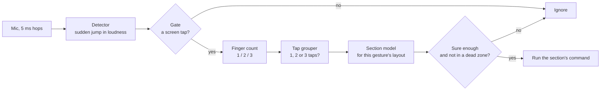

# Gesture system

> [!abstract] In one paragraph
> Today tapzones knows one gesture, a single tap, in four fixed quadrants. The gesture
> system lets the user choose **which gestures** they use (single, double, triple,
> 2-finger, 3-finger tap) and, for each one, **which sections** of the screen mean
> something. Every section triggers its own command. A layout the mic can't reliably
> tell apart shows its expected accuracy while the user designs it, so the user can
> choose a better one.

## Why

> [!bug] The problem that started this
> The closer a tap is to the centre of the screen, the more often it triggers a
> different quadrant. That's expected from the research: left/right mistakes cluster at
> the vertical centre line and the far edges ([[research#4. Where the remaining errors are: left vs right|research §4]]).
> Fixed quadrants put a border exactly where the mic is least sure.

A user-defined layout fixes this three ways:
1. **Fewer, larger sections:** two halves instead of four quadrants, when that's all
   someone needs.
2. **Layouts the mic is good at:** horizontal bands (rows) are about 2.4× easier to tell
   apart than columns. See [[Sections#Rows beat columns]].
3. **Dead zones:** gaps between sections where a tap does nothing, so that taps near a
   border are ignored instead of guessed.

## The five gestures

| Gesture | What the user does | Sections | Status |
|---|---|---|---|
| **Single tap** | One tap | 1 – 5 recommended (default 4: quadrants, today's behaviour) | Works today as quadrants |
| **Double tap** | Two taps in quick succession, same section | 1 – 5 (default 2: top/bottom halves) | Planned: [[Multi-tap]] |
| **Triple tap** | Three taps in quick succession, same section | 1 – 5 (default 1: anywhere) | Planned: [[Multi-tap]] |
| **2-finger tap** | One tap with two fingers at once | 1 – 5 (default 1: anywhere) | Research needed: [[Multi-finger]] |
| **3-finger tap** | One tap with three fingers at once | 1 – 5 (default 1: anywhere) | Research needed: [[Multi-finger]] |

> [!info] Limits, the same for every gesture
> - **Minimum 1 section.** One section means "anywhere on the screen".
> - **Recommended maximum 5.** The user may set more. The editor then warns, and shows
>   the expected accuracy of the layout ([[Sections#Why 5 is the recommended maximum]]).
> - A gesture can be **turned off** completely. Turning off double and triple tap
>   also removes the delay they add to single taps ([[Multi-tap#The single-tap delay]]).

Settled design decisions:
- Sections are made from **presets plus dragged rectangles**, with optional **dead zones**.
- Every tap of a double or triple tap must land in the **same section**. There are no
  sequences like "top, then bottom".
- Multi-finger taps use the same section system, but **default to one section**
  until research shows the mic can place them ([[Research plan#5. Multi-finger taps]]).

## How a sound becomes a command

- **Detector and gate:** these exist today ([[training#The tap-or-not gate (noise)|the gate]]).
- **Finger count:** new. Its feasibility is unknown ([[Multi-finger]]).
- **Tap grouper:** new. It waits a short window for more taps ([[Multi-tap]]).
- **Section model:** replaces the 4-quadrant model. It is trained for the user's layout,
  from taps already recorded ([[Calibration and training]]).
- **Commands and layouts:** these live in one config file ([[Configuration]]).

## Notes in this folder

| Note | What it covers |
|---|---|
| [[Sections]] | Presets and adjusting them, dead zones, why rows beat columns, the limit of 5, the centre problem |
| [[Multi-tap]] | Double and triple taps: grouping, timing, the detector changes, combining evidence |
| [[Multi-finger]] | 2- and 3-finger taps: what the mic might hear, and what's unknown |
| [[Configuration]] | The config file, the limits and validation, an example |
| [[Calibration and training]] | Where each gesture's training data comes from, and how models are built |
| [[Research plan]] | Experiments to run before and while building, with pass bars |
| [[Roadmap]] | Phases and tasks, in order |

## Related

- [[README|Home]]: the project overview
- [[research]]: why the model works the way it does
- [[training]]: recording data and retraining today's model
