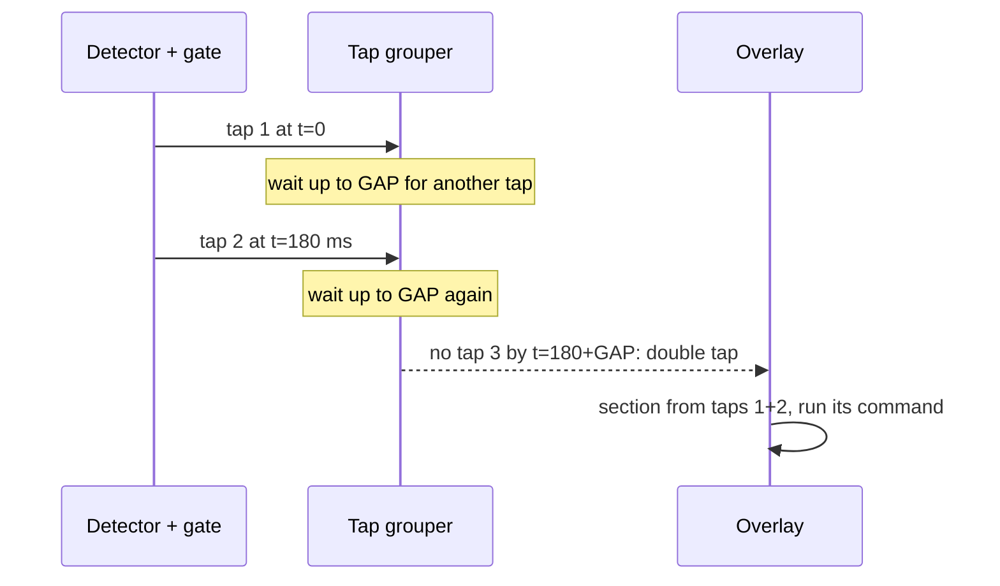

# Double and triple taps

A **double tap** is two taps in quick succession, and a **triple tap** is three. Every tap
must land in the **same section** of that gesture's layout ([[Sections]]). Sequences
such as "top, then bottom" are not gestures.

| Gesture | Default layout | Recommended limit |
|---|---|---|
| Double tap | 2 sections: top / bottom halves | 1 – 5 |
| Triple tap | 1 section: anywhere | 1 – 5 |

## Grouping taps

A **tap grouper** sits after the gate ([[Gesture system#How a sound becomes a command]]).
It collects taps that come close together:

- **GAP:** the longest pause between taps that still counts as one gesture. It's
  proposed at about 350 ms, and the real value comes from measuring how people
  double-tap ([[Research plan#4. Multi-tap timing]]).
- **More than 3 taps** in a row isn't a gesture: the grouper ignores the whole run.
- **Mixed sections:** if the taps land in different sections, nothing runs. The overlay
  briefly shows which sections it heard, so the user learns the limits.
- **Mixed finger counts** (a 2-finger tap and then a single tap) don't form a group.

## The single-tap delay

> [!warning] Trade-off
> When double or triple tap is turned on, a single tap is only known to be single once
> GAP has passed with no second tap. That adds about GAP (~350 ms) to every single tap.

How the design limits it:
- **Only when needed.** With double and triple tap off, single taps answer at 45 ms as
  today ([[latency]]).
- **Early feedback.** The tap's section is still computed at 45 ms and shown dimmed
  straight away. The command runs when the gesture is known.
- **Per section.** If a section is used by single tap but no double-tap section
  overlaps it, a single tap there needs no wait.

## Detector changes

Today's detector (`tapzones/audio.py`, `Mic.run`) would lose most double taps:

| Today | Why it's a problem | Change |
|---|---|---|
| A 300 ms lockout after each tap (`count - last_tap > 60` hops) | A double tap's second tap often comes within 300 ms | Shorten it to about 80–100 ms: long enough to skip one tap's own ringing |
| Detection waits on a full 150 ms window (`POST_HOPS = 30`) | Tap 2 can start inside tap 1's window | Detect from the onset alone. Each tap keeps its own 45 ms early window ([[latency]]) |
| A key press mutes the mic for 0.4 s | No change needed | — |

> [!question] Open: ringing overlap
> If tap 2 lands within about 45 ms of tap 1, tap 1's early window contains the start
> of tap 2. That's faster than people double-tap (typically 100–250 ms between taps),
> but it has to be checked on real recordings ([[Research plan#4. Multi-tap timing]]).

## Combining the taps' evidence

Every tap of a multi-tap lands in the same section, so the section model scores each
tap separately and the scores are **multiplied**:

$$
P(\text{section } s) \propto \prod_{i=1}^{n} P_i(s)
$$

- When two taps agree, the answer gets more certain than either tap alone. When they
  disagree, the result is spread out and falls below the cutoff.
- This makes double taps a natural fit for **harder layouts**: more sections, or
  columns. That's measured in [[Research plan#3. Combining the taps of a double tap]].

> [!success] Measured (simulated from single taps)
> `research/experiments.py double_sim` takes the out-of-session section probabilities of 2 or 3
> different recorded taps from the same section, and multiplies them:
>
> | Layout | Single | Double | Triple |
> |---|---|---|---|
> | Top / bottom | 94.0% | 97.7% | 98.6% |
> | Left / right | 87.7% | 94.2% | 93.6% |
> | Quadrants | 84.6% | 92.5% | 93.2% |
> | 3 columns | 78.6% | 89.4% | 91.7% |
> | 5 rows | 71.0% | 78.9% | 83.5% |
>
> Real double taps land closer together than two random taps in a section, so their
> errors are more alike. Expect a smaller gain than this once double taps are recorded.

## Training data

- Single-tap data already covers where taps land. A double tap is, acoustically, two
  single taps.
- Still needed: **recordings of real double and triple taps**, to measure the gaps and
  the overlap, and to check that the second tap sounds like a single one (the lid may
  still be moving). See [[Calibration and training#New recording modes]].

## Related

- [[Gesture system]]: the hub
- [[Sections]]: the layouts the taps land in
- [[Multi-finger]]: the other new gestures
