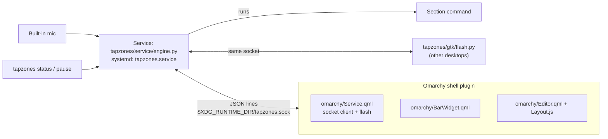

# Omarchy plugin

tapzones is one folder that works two ways:
- **On Omarchy** it's a shell plugin (`meshwa.tapzones`). It has a bar icon, the flash
  drawn in your theme, and the layout editor inside the shell.
- **On any other Linux desktop** the same service runs. A small GTK client draws the
  flash, and `tapzones layout` opens the GTK editor.

## How it fits together



- **The service owns the mic and the models.** systemd starts it, so restarting the
  shell or reloading the plugin never interrupts listening, and never reloads the
  models (a few seconds).
- **Front-ends only talk to the socket.** The protocol is documented at the top of
  `tapzones/service/engine.py`.
- **The socket is private.** It lives only in `$XDG_RUNTIME_DIR`, and only if that is a
  real directory that just you can open. There is no fallback to `/tmp`: anyone who
  can reach the socket can save section commands, and those run as you.
- **While the editor is open** it tells the service `editing`, and taps run nothing.
  The GTK overlay (`tapzones calibrate`/`test`/`collect`…) does the same with its lock
  file.
- **Feedback.**
  - With `feedback = "flash"`, a connected UI draws the flash.
  - If no UI is connected, the service sends a notification instead, so feedback never
    silently disappears.
  - With `notify`, the service always sends notifications. Omarchy's notification
    daemon themes them.

## Install

**On Omarchy:**

```sh
omarchy plugin add https://github.com/Meshwa428/tapzone --enable
~/.config/omarchy/plugins/meshwa.tapzones/install.sh
```

Alternatively, add the plugin and click its bar icon. While the service isn't running,
a click opens a terminal running `install.sh`.

**Anywhere else:**

```sh
git clone https://github.com/Meshwa428/tapzone ~/.local/share/tapzones/app
~/.local/share/tapzones/app/install.sh
```

What `install.sh` does:
1. **Checks** for `parec` and Python 3.11+. Off Omarchy, it also checks for GTK 4,
   PyGObject and gtk4-layer-shell.
2. **Python env:** creates `~/.local/share/tapzones/venv` (uv if present, else venv)
   and installs this folder into it as an editable package (`pyproject.toml`). `--full`
   adds torch and matplotlib, for the overlay's ensemble and research.
3. **The command:** links `~/.local/bin/tapzones` to the env's `tapzones`. It runs the
   code in this folder, so an update is a pull plus a service restart.
4. **systemd:** fills in the unit templates in `systemd/`, installs them to
   `~/.config/systemd/user/`, and enables them:
   - `tapzones.service` everywhere;
   - `tapzones-flash.service` only off Omarchy.
5. `--uninstall` removes the units and the command. Recordings, models and config stay.

> [!info] Why the venv lives outside the plugin folder
> `omarchy plugin add` rejects any plugin folder that contains a symlink, and a Python
> venv is full of them. Keeping it in `~/.local/share/tapzones` also means
> `omarchy plugin update` can never break it.

> [!warning] A new laptop has to learn first
> The models are this laptop's: they learned its lid and its mic. On another machine,
> record taps first (`tapzones collect`, [[training]]), then train
> ([[Calibration and training]]). The mic is the built-in one by default. Set
> `TAPZONES_SOURCE` in the unit to use another PulseAudio source.

## Using it on Omarchy

| Where | What |
|---|---|
| Bar icon | Bright: listening. Dim: paused, or the service is down. Highlighted: a section model is training. The tooltip shows the model's accuracy and the last tap |
| Bar icon, click | The layout editor ([[Sections#Making a layout]]). Its chips and keys work the same as the GTK editor's ([[usage]]). Under the command field, one-click Omarchy actions fill the command |
| Bar icon, right click | Pause / resume (kept across restarts) |
| `tapzones pause` / `resume` / `toggle` | The same from a keybinding or script |
| `omarchy-shell shell summon meshwa.tapzones '{}'` | Opens the editor, e.g. from a keybinding |

## Developing the plugin

The repo can stand in for the installed plugin:

```sh
ln -s ~/Documents/Projects/tapzones ~/.config/omarchy/plugins/meshwa.tapzones
omarchy-shell shell rescanPlugins && omarchy plugin enable meshwa.tapzones
```

> [!tip] Reloading QML
> The shell keeps a compiled copy of plugin QML. After editing `omarchy/*.qml`, run
> `omarchy restart shell` to see the change. Errors show up in
> `journalctl --user -t omarchy-shell` (look for `tapzones`).

The development link is fine for the shell, but `omarchy plugin validate` would refuse
the repo because of its `.venv`. Validate a clean copy instead (`git clone`, or an rsync
without `.venv`).
